# Zahln — Mensa Lunch Rush

Students pay for lunch in the mensa with their phone. This repo has the three apps that make
that work:

| App | Who uses it | Runs on | Folder |
|---|---|---|---|
| **Student app** | Students, staff and guests who pay | Android and iOS phones | `apps/student` |
| **Till** | The cashier at the mensa | Android tablets and iPads | `apps/till` |
| **Dashboard** | The Studierendenwerk's finance team | Web browser | `apps/dashboard` |

All three talk to Zahln's test server at https://dev.zahln.de. Code they share (payment
rules, the server client, translations, UI parts) lives in `packages/`.

**How a payment works:** the cashier taps the items on the till, and the till shows a QR
code. The student scans it, sees the mensa, the items and **their** price, and confirms with
fingerprint or PIN. The till shows "Paid" as soon as Zahln confirms it. The next morning,
finance checks the day on the dashboard.

**Why the QR has no price:** the same lunch costs a different amount for a student, a staff
member and a guest. The till doesn't know who will pay, so it shows all three prices, and
the price is settled when someone scans.

## Screenshots

### Student app

| Choose a test user | Home | Confirm the payment | Enter the PIN |
|---|---|---|---|
| 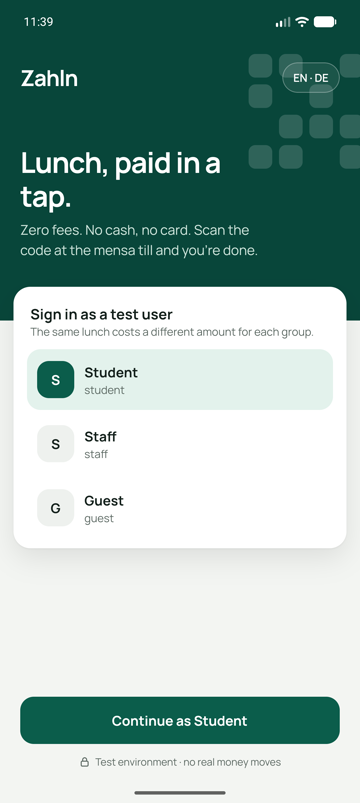 | 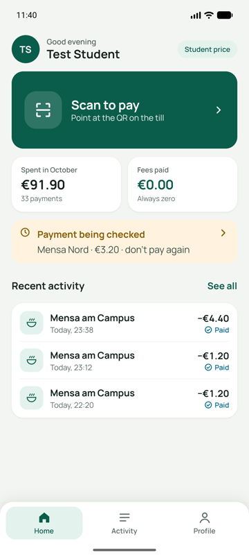 | 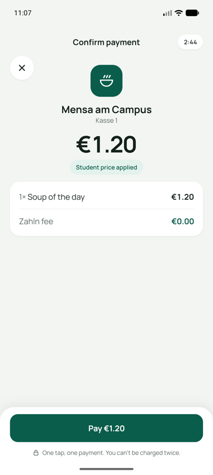 | 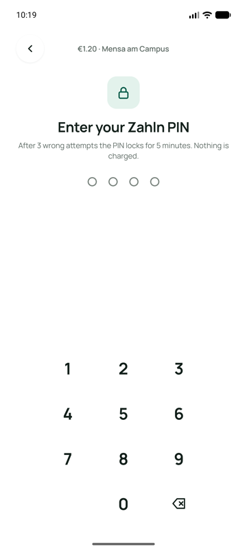 |

| Paid | Past payments | Profile (dark mode) |
|---|---|---|
| 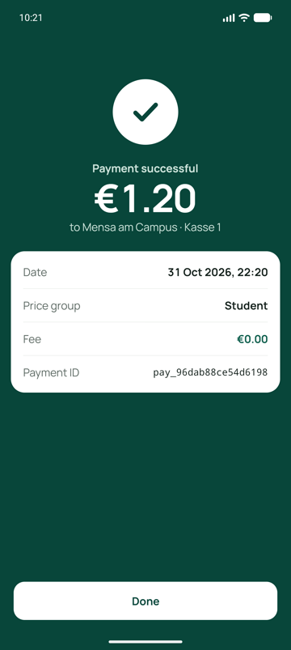 | 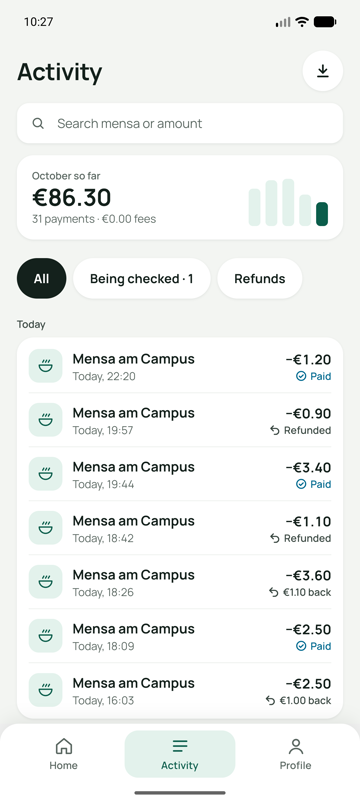 | 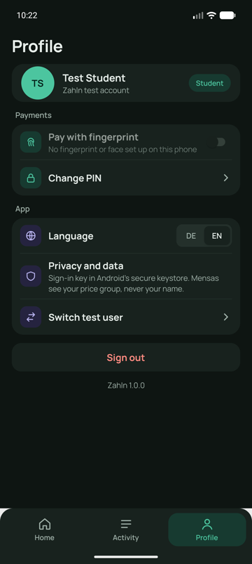 |

### Till

| Sign in | Menu |
|---|---|
| 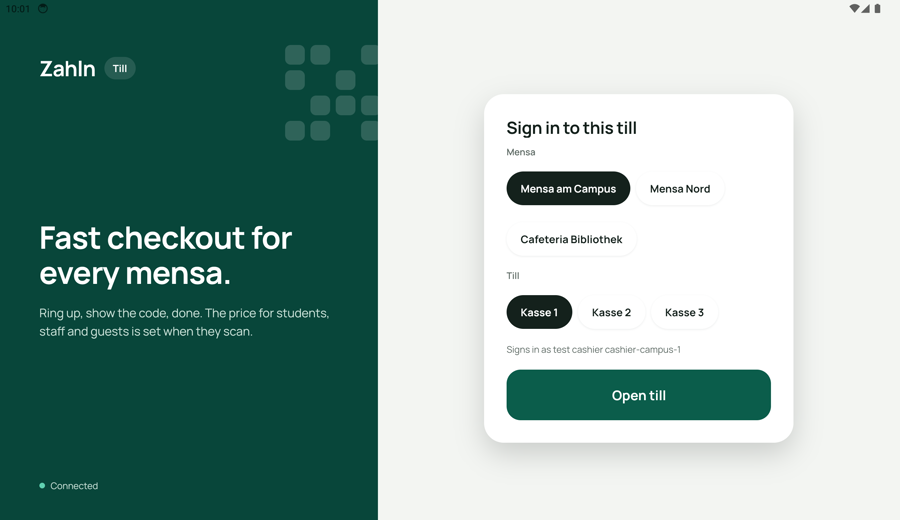 | 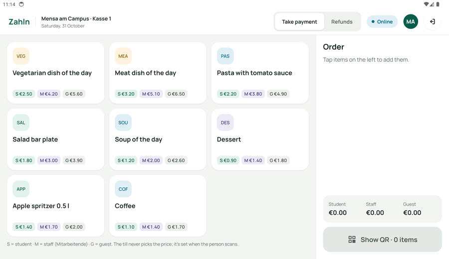 |

| QR code, with all three prices | Paid |
|---|---|
| 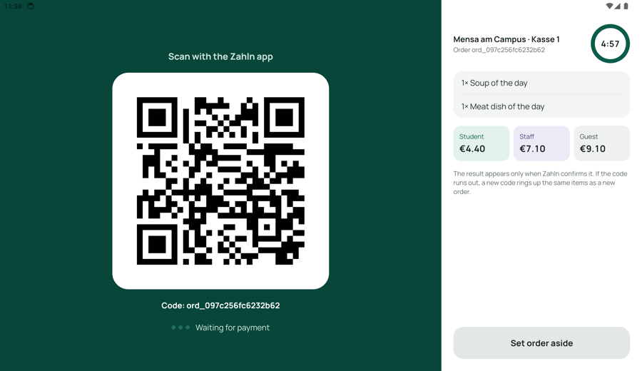 | 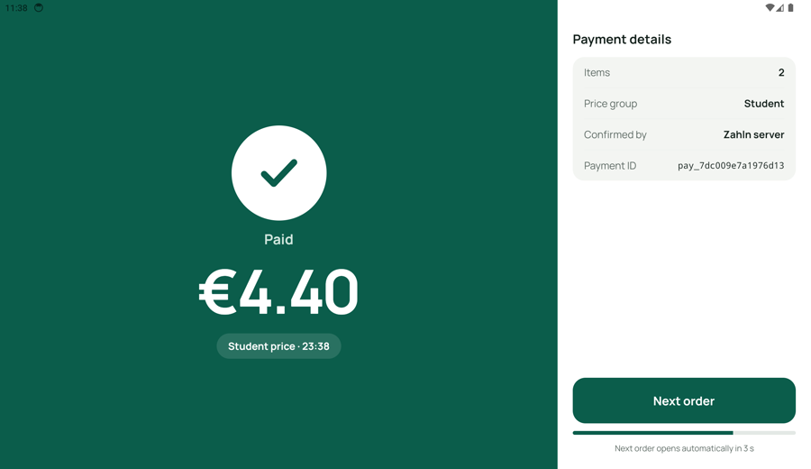 |

| Refund in full or in part | Refunded |
|---|---|
| 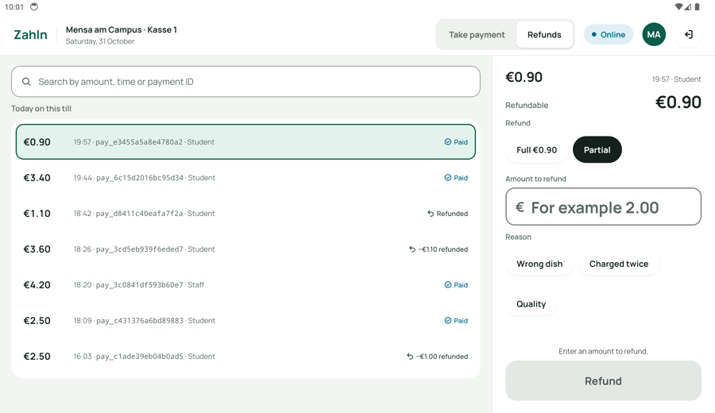 | 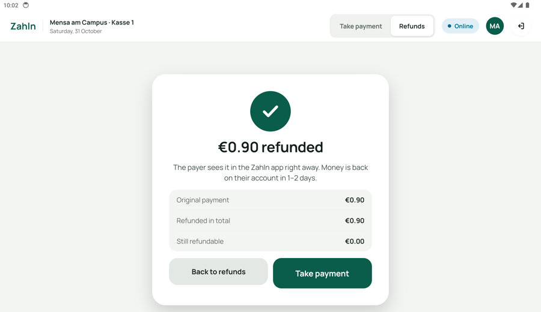 |

### Dashboard

| Overview of a day | Payments that need attention |
|---|---|
| 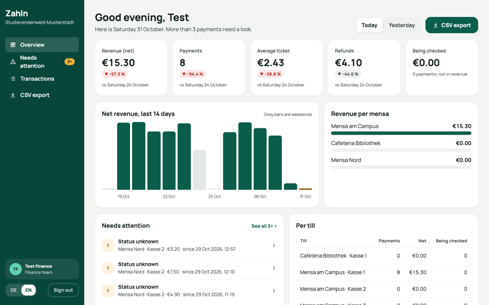 | 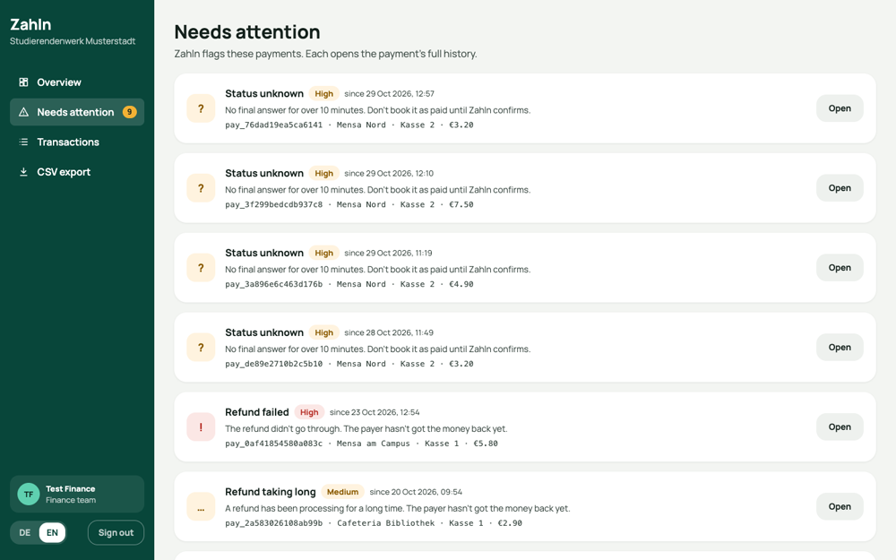 |

| A payment's full history | CSV export |
|---|---|
| 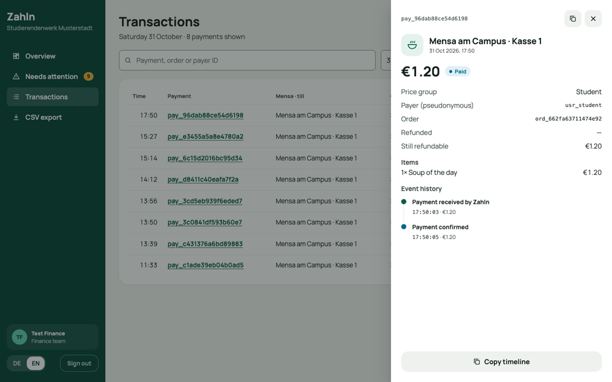 | 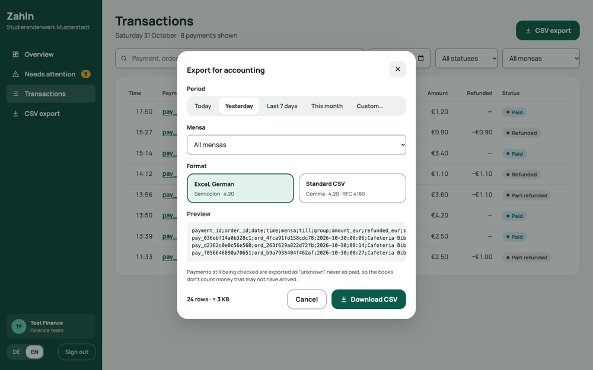 |

## What each app does

**Student app**
- Choose a test user: student, staff or guest. The same order shows a different price for each.
- Set a PIN, and turn on the fingerprint if the phone has one.
- Scan the till's QR (or type the code under it), see the mensa, the items and the price.
- Confirm with fingerprint or PIN, then see the result: **paid**, **not paid** (nothing was
  charged), or **being checked** (the answer got lost, so the app keeps asking).
- See this month's spending, all past payments with search and filters, and a receipt for each.
- Profile: fingerprint on or off, change PIN, German or English, sign out.

**Till**
- Pick the mensa and the till.
- Tap items to build the order, then show the QR. It shows the student, staff and guest price.
- See the result as soon as Zahln confirms it.
- Refund a payment in full or in part, with a reason. If Zahln refuses, the till says why.
- Keeps working through a lost connection: it says so, and nothing is charged twice later.

**Dashboard**
- Sign in as the finance team.
- A day's totals: revenue, number of payments, refunds, per mensa and per till, against the
  same day a week before.
- The payments Zahln flags as needing attention.
- Search all payments and open any one to see its full history.
- Download a CSV for accounting: Excel (German) or standard format.

All three are in **German and English**. The student app's pay flow is built for screen
readers: every button has a label, amounts are read out in words, and every result is
announced.

## Never charging twice

This is the most important rule, so the apps follow it everywhere:

1. Before sending a payment, the phone saves it, with a unique key.
2. If the answer gets lost, the app asks Zahln again **with the same key**. Zahln never pays
   twice for one key.
3. Until Zahln answers, the screen says **"being checked"**, never "paid" or "failed".
4. If the app is closed in the middle, it picks the payment up again on the next start.

Refunds on the till work the same way.

## Test logins

All passwords are `test1234`. This is Zahln's test data: no real money, no real people.

| App | Login |
|---|---|
| Student app | `student`, `staff` or `guest`, chosen on the first screen |
| Till | `cashier-campus-1` … `cashier-bibliothek-1`, chosen by picking the mensa and till |
| Dashboard | `finance` (the sign-in page has a button that fills it in) |

**Android apps:** download [zahln-student.apk](apk/zahln-student.apk) and
[zahln-till.apk](apk/zahln-till.apk) from the `apk/` folder and install them on an Android
phone or tablet. **Dashboard:** run it on your computer, as shown below.

## Run it on your computer

You need **Node.js 20.19 or newer** and npm. For the student app and the till you also need
Android Studio (or Xcode for iOS).

```bash
npm install
npm run check        # typecheck, lint and all tests
npm run dashboard    # dashboard at http://localhost:5173
```

The student app and the till use the camera, fingerprint and secure storage, so they don't
run in Expo Go. Build them onto an emulator or a phone:

```bash
cd apps/student && npx expo run:android
cd apps/till && npx expo run:android
```

### Changing the server

Everything uses https://dev.zahln.de unless you change it:

| Setting | For |
|---|---|
| `EXPO_PUBLIC_ZAHLN_BASE_URL` | student app and till (set per build profile in `eas.json`) |
| `VITE_ZAHLN_BASE_URL` | dashboard |

In test builds you can switch server without rebuilding: long-press **"Test environment"**
on the student app's first screen, or **"Connected"** on the till's sign-in screen. The app
won't switch while a payment or refund is still open.

## Tests

`npm run check` runs every test. The tests never call the real server. They use a fake
Zahln server (`packages/testing`) that can drop, delay, repeat or reorder answers and end
sessions, just like a bad campus network. The server client is also checked against real
answers recorded from Zahln.

## Build and deploy

**Android APKs.** The APKs in `apk/` were built on a laptop for 64-bit ARM phones and
tablets (`arm64-v8a`). They point at dev.zahln.de and are signed with a test key: fine to
install from a file, not for the Play Store. To build them again:

```bash
cd apps/student                          # or apps/till
npx expo prebuild --platform android     # creates the android/ folder (not in git)
cd android
EXPO_PUBLIC_ZAHLN_BASE_URL=https://dev.zahln.de EXPO_PUBLIC_ALLOW_SERVER_CHANGE=true \
  ./gradlew assembleRelease -PreactNativeArchitectures=arm64-v8a
# the APK is in app/build/outputs/apk/release/app-release.apk
```

You can also build in the cloud with EAS. Each app's `eas.json` has a `preview` profile:

```bash
cd apps/student                          # or apps/till
npx eas-cli@latest login
npx eas-cli@latest init                  # once per app
npx eas-cli@latest build --platform android --profile preview
```

**Dashboard.** `npm run build -w @zahln/dashboard` creates a static website in
`apps/dashboard/dist`. Upload that folder to any static host; no extra settings are needed.

## What's left out, and why

| Left out | Why |
|---|---|
| A page to switch payments off | Zahln's API can't change that setting and has no operations login. Both apps **do** obey it when Zahln switches payments off |
| Our own "needs attention" rules | The API doesn't give the numbers needed; the dashboard shows Zahln's own flags |
| "Mark as resolved" on the dashboard | The API has no way to do it |
| Notifications | The API has no notification feed or push |
| "Report a problem" | The API has no support endpoint; the receipt shows the payment ID and can be shared |
| Statement as a PDF | The API has no statement; the month can be shared as text instead |
| Paying while offline | Money must be confirmed by Zahln; offline, the app says nothing was charged |
| Student app and till in a browser | Not asked for; fingerprint and secure storage need a phone |
| iOS store build | Needs an Apple developer account; the brief asks for Android. iOS works in the simulator |
| Offline copy of past payments after a restart | Kept in memory only, so after a restart without a connection the list is empty |
| Real company login for the dashboard | Uses the test login; reloading the page asks you to sign in again |
| Device checks, certificate pinning, PIN held by the server | Need work on the server side as well; not built for this test |

## Main libraries

| Library | Why |
|---|---|
| Expo SDK 58, Expo Router | Builds the student app and till for Android and iOS from one codebase |
| expo-local-authentication, expo-secure-store, expo-sqlite | Fingerprint; keeping the PIN and settings safe on the phone; saving payments so they survive a crash |
| expo-camera, qrcode | Scanning the QR on the phone; drawing it on the till |
| React 19, Vite, React Router | The dashboard |
| zod | Checks every answer from the server before the app uses it |
| i18next | German and English |
| Vitest, fast-check | Tests |
| Turborepo, ESLint | Running tasks across the repo; keeping the code layers apart |
